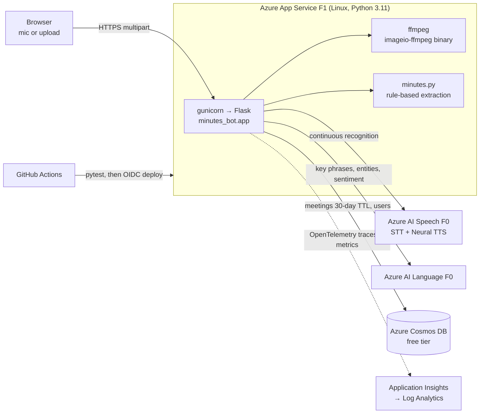
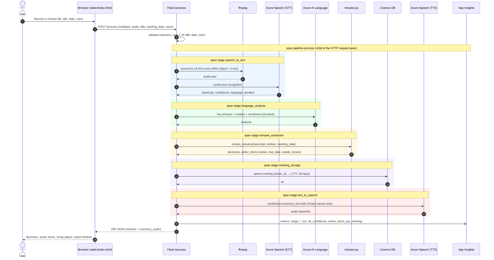
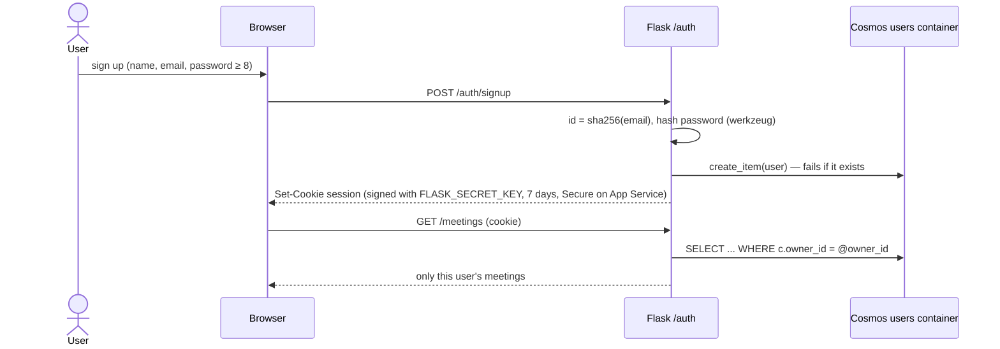
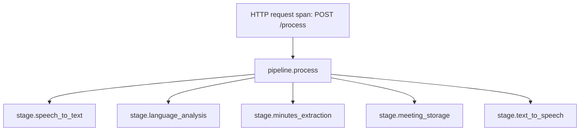
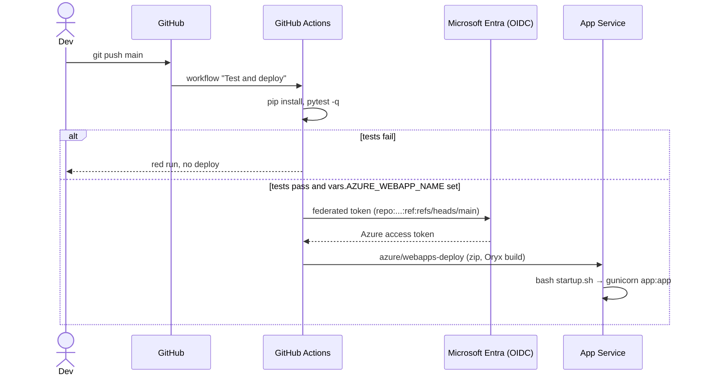

# Meeting Minutes Bot — System Design

## 1. Goal and scope

Turn a short meeting recording (≤ 3 minutes, ≤ 25 MB) into structured minutes:
decisions, action items with owner and due date, key topics, sentiment, a spoken recap,
and Markdown / calendar (.ics) exports. Each signed-in user sees only their own meetings,
which are kept for 30 days.

**Non-goals:** long recordings, speaker diarization, real-time streaming, multi-tenant orgs.

## 2. Architecture



## 3. Main flow — `POST /process` sequence



**Error path:** any stage raises `PipelineError(message, status)`. The `stage()` context manager
tags it with the stage key, the request span gets `event.name=pipeline_error` and `error.stage`,
and the client receives `{"error": "..."}` with the right status code (400/413/415/422/502/504).

## 4. Auth flow



## 5. Data model (Cosmos DB, database `minutes`)

| Container | Partition key | TTL | Throughput | Document |
| --- | --- | --- | --- | --- |
| `meetings` | `/id` | 30 days | 400 RU/s | `id, meeting_id, owner_id?, title, meeting_date, transcript, language, duration_seconds, confidence, decisions[], action_items[{id, task, owner, due_date, needs_review}], key_phrases[], entities[], sentiment{}, summary_text` |
| `users` | `/id` | none | 400 RU/s | `id = sha256(email), name, email, password_hash, created_at` |

Total 800 RU/s, inside the 1 000 RU/s free-tier allowance. Without `COSMOS_ENDPOINT`, `MemoryStore` is used (local dev, tests).

## 6. API

| Method | Path | Purpose |
| --- | --- | --- |
| POST | `/process` | full pipeline |
| POST | `/transcribe` | STT only |
| POST | `/analyze` | Language only (`{"text": ...}`) |
| GET | `/meetings`, `/meetings/{id}` | history, one meeting |
| GET | `/meetings/{id}/export?format=md\|ics` | exports |
| DELETE | `/meetings/{id}` | delete (owner only) |
| POST | `/auth/signup`, `/auth/signin`, `/auth/signout`; GET `/auth/me` | accounts |
| GET | `/telemetry-summary` | in-process session stats |

## 7. Observability



- **Traces:** Application Insights → Transaction search → a `POST /process` request → end-to-end view shows the stage spans (screenshot for Part G).
- **Domain metric:** `action_items_per_meeting` (histogram). Evidence query:

  ```kusto
  customMetrics
  | where name == "action_items_per_meeting"
  | summarize meetings = sum(valueCount), avg_items = sum(valueSum) / sum(valueCount) by bin(timestamp, 1h)
  ```
- **Other metrics:** `stt_confidence`, `stage_stt_ms`, `stage_language_ms`, `stage_extraction_ms`, `stage_storage_ms`, `stage_tts_ms`, entity/keyphrase counts.
- **Alert (G7):** `low-stt-confidence` — log alert on `stt_confidence` average below a threshold (not created yet).

## 8. Deployment and CI/CD



## 9. Key decisions and trade-offs

| Decision | Why | Trade-off |
| --- | --- | --- |
| Rule-based extraction (`minutes.py`) instead of an LLM | free, deterministic, testable with 5 fixture scripts | misses unusual phrasing; flags `needs_review` |
| F0 / F1 / Cosmos free tier everywhere | ~$0 credit spend | F1 has 60 CPU-min/day and cold starts; one slow worker |
| `imageio-ffmpeg` binary instead of `apt-get ffmpeg` at boot | apt-get on every start used up the F1 CPU quota | larger package |
| Regions `northcentralus` (AI) / `westus` (Cosmos, App Service) | Student subscription blocks `eastus`; capacity limits | cross-region latency (small) |
| Histogram for the domain metric | gauges keep only the last value per export | need `valueSum/valueCount` in KQL |
| `owner_id` filter, meetings without owner kept separate | per-user privacy for the UI | API callers without a session share an anonymous space |
